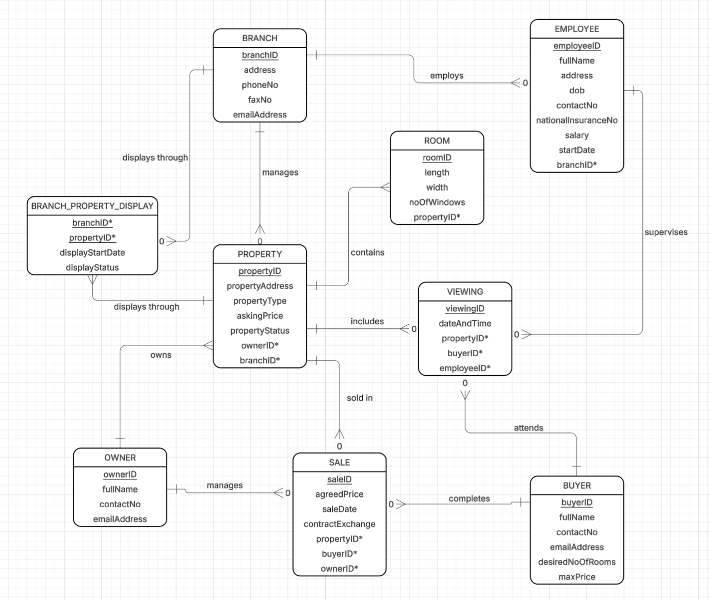

# Seaview Estate Agents Database

A relational database design and implementation for a fictional estate agency, created for my Data Management module at Bournemouth University.

The project covers the full path from design to working database: an entity relationship diagram (ERD), an Oracle SQL schema with constraints, test data, and report queries.

## Tools

- **Lucidchart** for the ERD
- **Oracle SQL** for the schema, test data and queries

## Entity relationship diagram

## Design decisions

- **Many-to-many relationships are resolved with associative entities.** `VIEWING` links buyers and properties, as a buyer can view many properties and a property can be viewed by many buyers. `BRANCH_PROPERTY_DISPLAY` links branches and properties, as a property can be displayed at several branches.
- **Two separate relationships between branch and property.** Each property is managed by exactly one branch (one-to-many), while display across branches is many-to-many.
- **Optional relationships reflect real-world cases.** A branch can have no employees yet, a newly listed property can have no viewings, and a buyer can view properties without buying any.
- **Room details live in their own table.** Length, width and number of windows vary per room, so storing them in `PROPERTY` would create redundancy.
- **Identifiers are consistent** (`branchID`, `propertyID` and so on) across all tables.

## Tables in the SQL script

| Table | Purpose |
|---|---|
| `BRANCH` | Agency branches |
| `OWNER` | Property owners |
| `EMPLOYEE` | Staff, each assigned to one branch |
| `BUYER` | Buyers, with desired room count and maximum price |
| `PROPERTY` | Properties, with owner, managing branch and status |
| `ROOM` | Rooms belonging to a property |
| `VIEWING` | Viewings linking a buyer, property and employee |

Primary keys, foreign keys, `NOT NULL`, `UNIQUE` (National Insurance number) and `DEFAULT` constraints are used to keep the data consistent.

## Example queries

- **Report 6:** all viewings for a property, with the buyer and employee names (joins across four tables).
- **Report 10:** every property with its room count, using a `LEFT JOIN` so properties with no rooms still appear with a count of 0.

## How to run

1. Open `seaview_estate_agents.sql` in Oracle SQL Developer or SQL*Plus (Oracle 12c or later, as the script uses identity columns).
2. Run the whole script. On a first run, the `DROP TABLE` lines at the top will show "table does not exist" errors, which are safe to ignore.
3. The script creates the tables, inserts the test data and runs the two report queries.

All names, addresses and contact details in the test data are fictional.

## Security and data protection

The design considers the CIA triad (confidentiality, integrity and availability) and UK data protection law (UK GDPR and the Data Protection Act 2018). In a real deployment, role-based access would restrict sensitive employee data such as salaries and National Insurance numbers to management staff only.

## Not included in the script

The ERD also includes `SALE` and `BRANCH_PROPERTY_DISPLAY` entities, which are part of the design but not yet implemented in the SQL.
